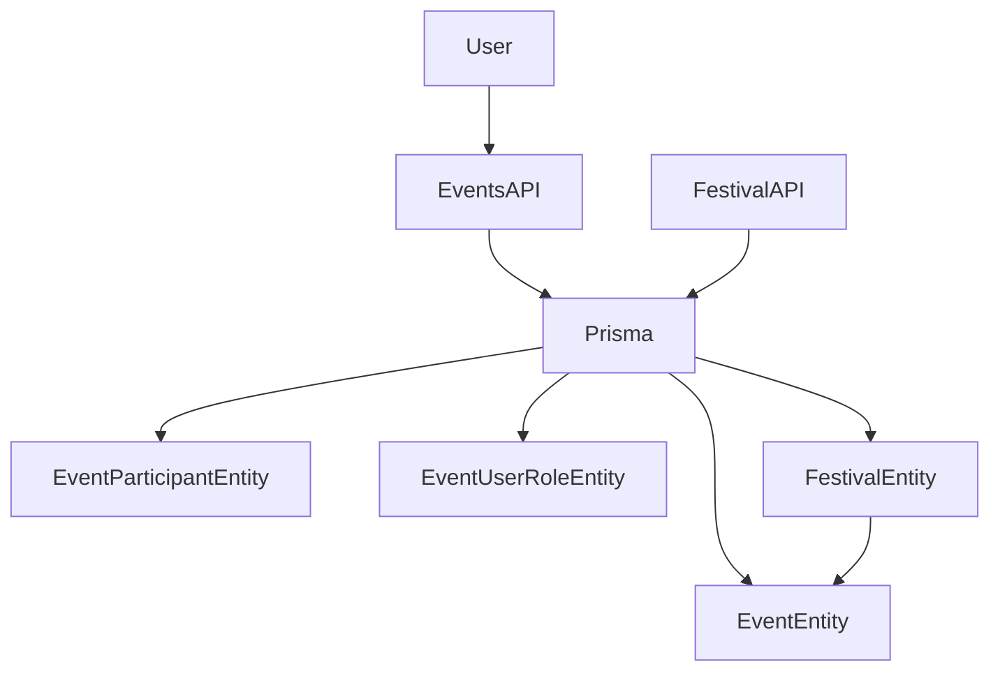

# Implement Events (minimal hackathon-like)

## Decisions locked

- **Scope**: Backend + DB + shared types only.
- **Participation**: Tracked in DB (join/leave), enforce **userLimit**, keep **participantCount**.
- **Roles**: Mirror hackathon resource roles: **OWNER + MANAGER + EVALUATOR**.
- **Payments**: Metadata only (store `isFree`, `entryFeeAmount`, `currency`), no payment provider.
- **API shape**: New `/events` resource; festival responses should include `events` alongside `hackathons`.

## Important terminology correction (so we don’t bake in inconsistencies)

- In the current system, “online/offline” is represented primarily by **location** via `LocationType` = `PHYSICAL` | `VIRTUAL` (and hackathons additionally have `mode` = `ONLINE` | `OFFLINE` | `HYBRID`). For **Events**, we’ll treat your “online/offline” requirement as **`location.type` (VIRTUAL/PHYSICAL)** and keep Events minimal (no separate `mode` unless you explicitly want HYBRID for Events later).

## Data model changes (Prisma)

Files:

- [`/Users/harshit/Documents/freelance/oppskills-core/packages/database/prisma/schema.prisma`](../../../Users/harshit/Documents/freelance/oppskills-core/packages/database/prisma/schema.prisma)

Add new models (names can be adjusted, but plan assumes these):

- **`EventEntity`**
- Core: `id`, `slug` (unique), `name`, `description`, `startDate`, `endDate`, `status: LifecycleStatus`
- Festival link: `festivalId?` → `FestivalEntity`
- Location (reuse existing denormalized fields): `locationType`, `locationAddress`, `locationCoords`, `locationVirtualLink`
- Pricing: `isFree`, `entryFeeAmount Decimal?`, `currency`
- Capacity: `maxUsers Int?`, `registrationCount Int @default(0)` (or `participantCount`—we’ll pick one and standardize)
- Ownership: `ownerId` → `UserEntity`
- Relations: `participants`, `userRoles`
- **`EventParticipantEntity`** (join table)
- `eventId`, `userId`, `joinedAt`, unique(`eventId`,`userId`)
- **`EventUserRoleEntity`** (per-event roles)
- `eventId`, `userId`, `role: EventUserRole`, unique(`eventId`,`userId`,`role`)
- **New enum `EventUserRole`** = `MANAGER | EVALUATOR` (separate from `HackathonUserRole` to avoid semantic coupling)

Update existing models:

- **`FestivalEntity`**: add relation `events EventEntity[]`
- **`UserEntity`**: add relations for created events (`events`), assigned event roles, and event participations

Migration + generation steps (after plan approval):

- Create Prisma migration (`pnpm db:migrate` or repo’s preferred migration command)
- Regenerate Prisma client (`pnpm db:generate`)
- Rebuild `@oppskills/db` package so backend sees new client types

## Shared Types changes (`@oppskills/types`)

Files:

- Add new DTOs under [`/Users/harshit/Documents/freelance/oppskills-core/packages/types/src/dtos/backend/`](../../../Users/harshit/Documents/freelance/oppskills-core/packages/types/src/dtos/backend/)

Create:

- `backend/event/create-event.dto.ts`
- `backend/event/update-event.dto.ts`
- `backend/event/event-roles.dto.ts`
- `backend/event/index.ts` and export via existing barrel files.

DTO patterns to mirror:

- Follow the strict patterns used in [`packages/types/src/dtos/backend/hackathon/create-hackathon.dto.ts`](../../../Users/harshit/Documents/freelance/oppskills-core/packages/types/src/dtos/backend/hackathon/create-hackathon.dto.ts)
- **No `any`**, no non-null assertions, double-quoted strings
- `class-validator` + `class-transformer` + `@nestjs/swagger` annotations
- Location DTO reuse pattern (`type/address/city/virtualLink`) and validation (`PHYSICAL` needs address; `VIRTUAL` needs link)

## Backend implementation (NestJS)

Files:

- Add new module folder: [`/Users/harshit/Documents/freelance/oppskills-core/apps/backend/src/event/`](../../../Users/harshit/Documents/freelance/oppskills-core/apps/backend/src/event/)
- Update app wiring: [`/Users/harshit/Documents/freelance/oppskills-core/apps/backend/src/app.module.ts`](../../../Users/harshit/Documents/freelance/oppskills-core/apps/backend/src/app.module.ts)
- Update festival includes: [`/Users/harshit/Documents/freelance/oppskills-core/apps/backend/src/festival/festival.service.ts`](../../../Users/harshit/Documents/freelance/oppskills-core/apps/backend/src/festival/festival.service.ts)

Add:

- `event.module.ts` (like `hackathon.module.ts`)
- `event.controller.ts` (guarded by `ClerkAuthGuard`, Swagger documented)
- `event.service.ts` (Prisma CRUD + validation + permission checks)

Endpoints (initial set):

- **CRUD**: `POST /events`, `GET /events`, `GET /events/:id` , GET /events/by-slug/:slug `PUT /events/:id`, `DELETE /events/:id`
- **Status**: `PATCH /events/:id/status`
- **Participation**: `POST /events/:id/join`, `DELETE /events/:id/leave`
- Enforce: not owner joining, not double-join, maxUsers limit, lifecycle/registration deadline if we add it
- Maintain `registrationCount` transactionally
- **Roles**: `GET /events/:id/roles`, `POST /events/:id/roles`, `DELETE /events/:id/roles/:roleId` (or a body-based removal)
- Permission: owner OR admin; (optional) manager can do some actions—define explicitly
- **My events**: `GET /events/my` (owner or role holder), mirroring `GET /hackathons/my`

Festival integration:

- Update `FestivalService` includes to return `events` alongside `hackathons` for `createFestival`, `listFestivals`, `getFestivalById`, `updateFestival`.

## Docs update

Files:

- [`/Users/harshit/Documents/freelance/oppskills-core/docs/api.md`](../../../Users/harshit/Documents/freelance/oppskills-core/docs/api.md)

Add a new **Events** section mirroring the Hackathons section style (request/response examples, error responses).

## Notes / known gap we’ll avoid copying

- Current `POST /hackathons/:id/register` is effectively a stub (does not persist registration). For Events, we will implement real persistence via `EventParticipantEntity`, since you explicitly want user limits and join/leave tracking.

## Quick data-flow diagram

