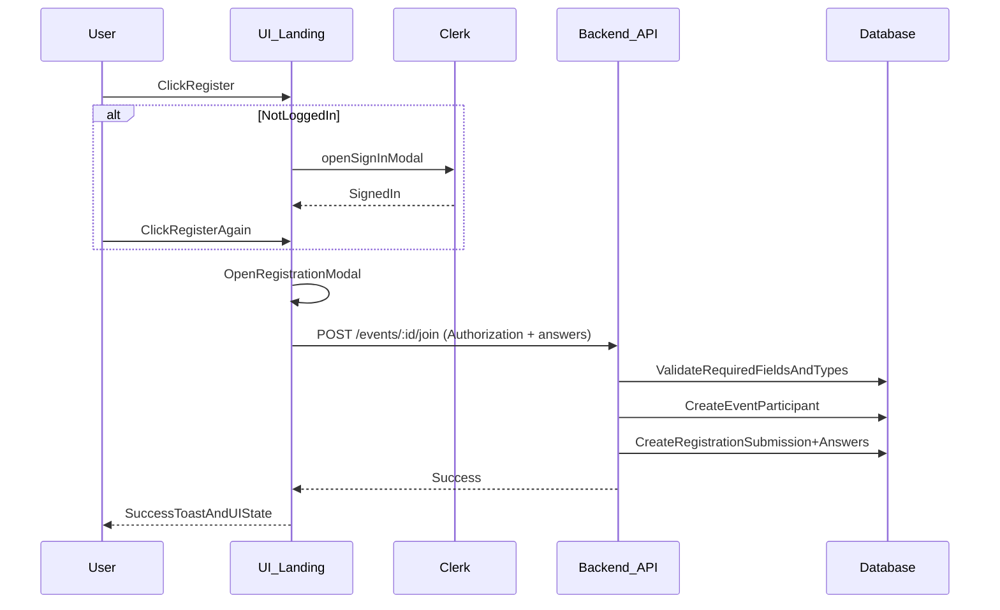

# Event Registration Modal (Auth + Persisted Answers)

## Key decisions
- **Auth required**: If the user is logged out and clicks **Register**, we will open the **Clerk sign-in modal** (no registration modal shown until signed in).
- **Questions source**: Questions come from the event’s `registrationForm.fields` (already returned by `GET /events/by-slug/:slug`).
- **Persist answers**: We will store submitted answers in the database.
- **Attachments**: v1 will **not** support `ATTACHMENTS` fields; frontend will show a clear message and backend will reject submissions containing unsupported field types.

> Terminology correction (important): the backend currently supports joining via `POST /events/:id/join`, and it stores participants, but it **does not yet accept or persist registration answers**. We’ll add that persistence now.

## Current code touchpoints (already in repo)
- Public event page uses a stubbed handler: `/Users/harshit/Documents/freelance/oppskills-core/apps/ui-landing/src/app/events/[slug]/page.tsx`.
- Event details include `registrationForm.fields`: `/Users/harshit/Documents/freelance/oppskills-core/apps/ui-landing/src/hooks/usePublicEventBySlug.ts`.
- Backend join endpoint: `/Users/harshit/Documents/freelance/oppskills-core/apps/backend/src/event/event.controller.ts` (`POST :id/join`) and `/Users/harshit/Documents/freelance/oppskills-core/apps/backend/src/event/event.service.ts` (`joinEvent`).

## Flow (high level)

## Backend changes (NestJS + Prisma)
- **Schema** (`/Users/harshit/Documents/freelance/oppskills-core/packages/database/prisma/schema.prisma`):
  - Add `EventRegistrationSubmissionEntity` with `eventId`, `userId`, timestamps.
  - Add `EventRegistrationAnswerEntity` linked to submission and `EventRegistrationFieldEntity`.
  - Store answer in a type-safe way (recommended: `valueJson Json` plus optional `valueText String?` if you want easier querying).
- **DTOs & validation**:
  - In types package (`/Users/harshit/Documents/freelance/oppskills-core/packages/types/src/dtos/backend/event/...`), add `JoinEventDto` (or `EventRegistrationSubmissionDto`) with:
    - `answers: Array<{ fieldId: string; value: string | number | string[] }>` (no `any`)
  - Validate:
    - required fields must be present
    - type matches field type (`EMAIL`, `PHONE_NO`, `NUMBER`, `OPTIONS`, `TEXT`)
    - options are within allowed list
    - reject `ATTACHMENTS` for now with a clear 400
- **Join endpoint**:
  - Update `POST /events/:id/join` to accept an **optional** body (backward compatible), validate answers, then within the existing transaction:
    - create participant
    - increment `registrationCount`
    - create submission + answers

## Frontend changes (Next.js)
- **Auth gating** (`/Users/harshit/Documents/freelance/oppskills-core/apps/ui-landing/src/app/events/[slug]/page.tsx`):
  - Use Clerk client APIs (`useAuth`, `useClerk`) to detect logged-out state.
  - If logged out: `openSignIn()`.
- **Modal UI**:
  - Create a new modal component (e.g. `EventRegistrationModal`) that renders fields from `event.registrationForm.fields`.
  - Input components:
    - TEXT/EMAIL/PHONE_NO/NUMBER: standard inputs
    - OPTIONS: select/radio based on existing design system
    - ATTACHMENTS: show “Not supported yet” message
  - Client-side validation mirrors backend rules and produces friendly field-level errors.
- **API client** (`/Users/harshit/Documents/freelance/oppskills-core/apps/ui-landing/src/lib/api/eventApi.ts`):
  - Add a typed `joinEvent(token, eventId, payload)` that POSTs to `/${id}/join` with auth headers.
- **Success state**:
  - On success: toast + disable button or show “Registered”. (We’ll choose the minimal UI change: disable and change label.)

## Execution notes
- Use **pnpm** (repo has `pnpm-lock.yaml`).
- Keep strict TypeScript: **no `any`, no non-null assertions, no double-casts**, and use **double quotes** for strings.

