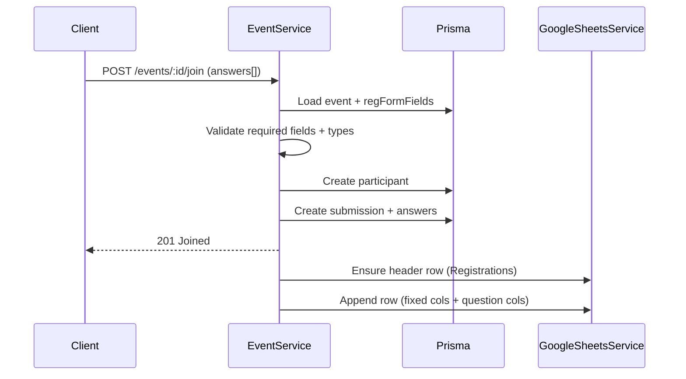

# Events flow fixes (verification + remaining work + Sheets logging)

## What’s already correct (verified)

- **Public vs dashboard split exists**: `apps/backend/src/event/event.controller.ts` now has `GET /events/public`, `GET /events/public/by-slug/:slug`, `GET /events/public/:id` and the dashboard detail endpoints `GET /events/by-slug/:slug` + `GET /events/:id` are now `@UseGuards(ClerkAuthGuard)`.
- **Roles endpoint is protected**: `GET /events/:id/roles` is now guarded and calls `getEventRolesWithPermission()`.
- **Create-event datetime serialization is fixed**: `apps/ui-landing/src/app/organize/event/page.tsx` uses `combineDateAndTimeToIso()` for `startDate`, `endDate`, and `registrationDeadline`.
- **Landing upcoming events removed obvious placeholders** and handles null deadlines: `apps/ui-landing/src/components/landingpage/UpcomingEvents.tsx`.
- **Tickets and Notifications have clear “UI-only” warning banners**: `apps/ui-landing/src/app/dashboard/events/[slug]/tickets/page.tsx` and `apps/ui-landing/src/app/dashboard/events/[slug]/notifications/page.tsx`.

## Remaining issues found (needs fixes)

### 1) Dashboard “limited editing mode” is incomplete (still calls DRAFT-only endpoints)

In `apps/ui-landing/src/app/dashboard/events/[slug]/edit-event/page.tsx`, the UI shows a banner for non-DRAFT events, but autosave still triggers:

- `updateEventAdditionalInfo()`
- `updateEventPrizeBreakdown()`
- `updateEventRegistrationForm()`
- `updateEventMaxUsers()`

Those backend endpoints are DRAFT-only (enforced by `assertEventEditableByUser()` in `apps/backend/src/event/event.service.ts`). So for non-DRAFT events, autosave will still fail, and worse, the UI currently lets the user edit registration questions (via `BasicDetails`) which then attempts to persist.

**Required fix**: In non-DRAFT mode, disable/hide DRAFT-only tabs/sections and prevent calling DRAFT-only API functions.

### 2) Dashboard “Registration Open/Closed” computation is wrong for DRAFT

`apps/ui-landing/src/app/dashboard/events/page.tsx` uses `isRegistrationOpen()` which currently treats DRAFT as open (it returns true unless cancelled/completed/paused/deadline/approval check applies). But the backend `EventService.joinEvent()` rejects DRAFT registrations.

**Required fix**: Make `isRegistrationOpen()` return `false` for DRAFT (and for any status not in PUBLISHED/ONGOING).

### 3) Registration questions mapping still includes unsafe assumptions

In `apps/ui-landing/src/app/dashboard/events/[slug]/edit-event/page.tsx`, the mapping for prizes and registration questions uses string casts for types (e.g. `attendeeEligibility as ...`, `visibility as ...`), and registration form updates currently always send `fields` without considering `externalFormLink`.

**Required fix**: Tighten mapping:

- Only send enum values that are known valid.
- Preserve `externalFormLink` when fields aren’t intended to overwrite it.
- In non-DRAFT mode, block registration form updates entirely.

### 4) Google Sheets logging is still “single answers column” and on Sheet1

Backend logging is currently:

- Triggered after join: `EventService.joinEvent()` calls `logToGoogleSheets(eventId, userId, answers ?? [])`.
- Writes 5 columns into `Sheet1!A1`: timestamp, event name, user name, email, and a single formatted answers string.

**Your requested change**: write to a dedicated `Registrations` tab, **auto-create/extend headers**, and log **one column per question**.

### 5) Server-side enforcement of required registration answers (you selected)

Current backend behavior loads `registrationFields` only if `answers.length > 0`. That means if a client sends `answers: []`, required questions are never enforced.

**Required fix**: Always load the event’s registration form (if any) during join and enforce required fields regardless of whether answers were provided.

---

## Updated implementation plan (what to change)

### A) Fix edit-event limited mode correctly (frontend)

**Files**:

- `apps/ui-landing/src/app/dashboard/events/[slug]/edit-event/page.tsx`
- `apps/ui-landing/src/app/dashboard/events/[slug]/edit-event/_components/BasicDetails.tsx`

**Work**:

- Detect non-DRAFT (already tracked via `eventStatus`).
- When non-DRAFT:
  - Disable/hide tabs that rely on DRAFT-only endpoints: `registration-settings`, `prizes`, `additional-info` (and anything else that triggers nested updates).
  - Make Registration Questions UI read-only or disabled (don’t open modal / don’t allow edits).
  - Update autosave mutation to:
    - Always allow `updateEvent()` with only basic info fields.
    - Skip calling nested update functions entirely.
- Add small UX cues on disabled sections (“Only editable in DRAFT”).

### B) Fix dashboard registration open/closed logic

**File**:

- `apps/ui-landing/src/app/dashboard/events/page.tsx`

**Work**:

- Update `isRegistrationOpen()` to match backend join rules:
  - Open only when status is **PUBLISHED or ONGOING**
  - approvalStatus must be **APPROVED**
  - `isRegistrationPaused` false
  - deadline not passed
  - (Capacity is not derivable reliably from list view; keep current candidates count display)
- Keep the `Switch` display-only unless you explicitly want it to toggle `PATCH /events/:id/registration`.

### C) Enforce required answers on join (backend)

**Files**:

- `apps/backend/src/event/event.service.ts`

**Work**:

- In `joinEvent(eventId, userId, answers)`:
  - Always fetch `eventRegistrationFormEntity` + fields for the event (or at least when a form exists).
  - If form has any `required: true` fields:
    - Require `answers` to be provided.
    - Require each required field to be present and non-empty.
    - Continue validating types/options.
  - If form exists and answers include unknown fieldId → reject.
  - Create `submission` + `answers` whenever answers are provided; for the “required fields exist” case this will always occur.

### D) Upgrade Google Sheets logging to “one column per question” with auto headers

**Files**:

- `apps/backend/src/event/event.service.ts` (log payload building)
- `apps/backend/src/google-sheets/google-sheets.service.ts` (extend API)

**Target behavior**:

- Use tab **`Registrations`**.
- Row 1 is the header row.
- On first write, create headers.
- If registration form fields change, extend headers by adding new question columns (never reorder existing columns).

**Proposed columns**:

- Fixed columns first:
  - `timestamp`
  - `eventId`
  - `eventName`
  - `userId`
  - `fullName`
  - `email`
  - `submissionId` (if present)
- Then one column per question using a stable header name:
  - Prefer `questionLabel (fieldId)` to avoid collisions when labels repeat.

**Implementation sketch**:

- Add GoogleSheetsService helpers:
  - `getRow(range)` to read header row
  - `updateRow(range, values)` to write headers
  - `appendRow(range, values)` already exists
- In `logToGoogleSheets()`:
  - Fetch event, user, registration form fields.
  - Compute header list.
  - Read existing header row from `Registrations!1:1`.
  - Merge headers (append any missing question columns).
  - Write merged header row back.
  - Build a row array aligned to header order and append to `Registrations!A:A` (or `Registrations!A1`).

### E) (Optional but recommended) Make Sheets logging use DB-saved answers for canonical data

To avoid any mismatch between client payload and stored values, you can log based on the created `submission` + `answers` records (fieldId/value), not the raw input array.

---

## Mermaid: registration → DB → Sheets

---

## Notes / small follow-ups

- Public endpoints currently include `contactName/contactEmail/contactPhone` and you confirmed that’s desired.
- `apps/ui-landing/src/hooks/useEvents.ts` currently defines `owner.email` in the list item type, but the public API doesn’t return owner email. Adjust type to match actual response (or add a mapping layer). This is a likely TS/runtime mismatch.
