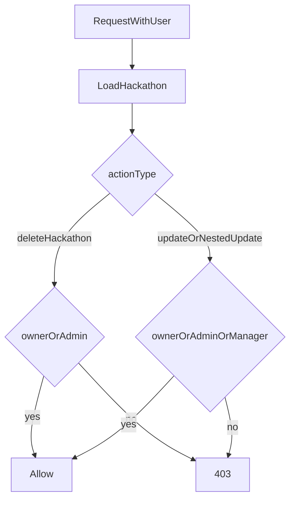

# Add Manager/Evaluator roles for opportunities (hackathons)

## Goals

- **Backend authorization**: allow **owner/admin/manager** to perform hackathon “edit/add/update” actions; keep **delete hackathon** restricted to **owner/admin only**.
- **Role management**: implement **per-hackathon** role management (Manager, Evaluator) editable by **owner/admin**.
- **UI**: convert `manage-roles` from mock state to real data backed by backend APIs.

## Key repo facts (current behavior)

- `apps/backend/src/hackathon/hackathon.service.ts` enforces edit permissions via `hackathon.ownerId !== userId` fallback to `isAdminUser(userId)` (e.g. `updateHackathon`, `assertHackathonEditableByUser`) and delete via the same pattern (`deleteHackathon`).
- `apps/ui-landing/src/app/dashboard/hackathon/[slug]/manage-roles/page.tsx` is currently **mock-only** (local state arrays) and not tied to backend.

## Data model changes (Prisma)

- Add a new join model to represent per-hackathon roles.
- **Enum**: `HackathonUserRole` with values `MANAGER`, `EVALUATOR`.
- **Model**: `HackathonUserRoleEntity` with:
    - `id` (cuid)
    - `hackathonId` → `HackathonEntity`
    - `userId` → `UserEntity`
    - `role` → `HackathonUserRole`
    - `createdAt`
    - `createdById` → `UserEntity` (who assigned the role)
    - Unique constraint: `@@unique([hackathonId, userId, role])`
- Update `HackathonEntity` and `UserEntity` relations to include this mapping.

Files:

- [`packages/database/prisma/schema.prisma`](packages/database/prisma/schema.prisma)

## Backend API additions (NestJS)

Add a small “roles” API under hackathons:

- `GET /hackathons/:id/roles`
- Returns owner + managers + evaluators (from DB relations), suitable for the UI.
- `POST /hackathons/:id/roles`
- Body: `{ email: string, role: "MANAGER" | "EVALUATOR" }`
- Looks up `UserEntity` by **email** (your chosen identifier).
- Validates:
    - email is non-empty and normalized
    - user exists in DB (otherwise `400`)
    - cannot add the owner as manager/evaluator (optional but recommended)
    - idempotent behavior on duplicates (either no-op or return 409; we’ll pick one and keep it consistent)
- Only **owner/admin** can call.
- `DELETE /hackathons/:id/roles`
- Query/body: `{ email: string, role: ... }` (we’ll pick one convention)
- Only **owner/admin** can call.

Files:

- [`apps/backend/src/hackathon/hackathon.controller.ts`](apps/backend/src/hackathon/hackathon.controller.ts)
- [`apps/backend/src/hackathon/hackathon.service.ts`](apps/backend/src/hackathon/hackathon.service.ts)
- (New) `apps/backend/src/hackathon/hackathon-roles.dto.ts` (Nest DTOs with validation)

## Backend authorization refactor

Centralize authorization so it’s hard to miss:

- Add helper methods in `HackathonService`:
- `isHackathonManager(hackathonId: string, userId: string): Promise<boolean>`
- `assertHackathonWritableByUser(hackathonId: string, userId: string): Promise<HackathonEntity>`
    - **Writable** = owner OR admin OR manager
- Keep `deleteHackathon` check as **owner OR admin only** (explicitly NOT managers).
- Replace existing owner/admin checks in edit/update endpoints (and internal asserts like `assertHackathonEditableByUser`) to use the new “writable” check.

Scope note:

- Evaluators remain **read-only** for now and are **not** included in writable checks.

## Frontend: wire up Manage Roles UI

Update `manage-roles` to use real data:

- Replace `MOCK_OWNER`, `INITIAL_MANAGERS`, `INITIAL_EVALUATORS` with data from `GET /hackathons/:id/roles`.
- Update modal to add by **email** + role type.
- Delete removes role using backend `DELETE` endpoint.
- Display fields based on what `UserEntity` actually has (`email`, `firstName`, `lastName`, `imageUrl`).
- The current UI has `phone`; since DB user model doesn’t include phone, we’ll either remove it from the UI or show it as blank/optional.

Files:

- [`apps/ui-landing/src/app/dashboard/hackathon/[slug]/manage-roles/page.tsx`](apps/ui-landing/src/app/dashboard/hackathon/[slug]/manage-roles/page.tsx)
- `apps/ui-landing/src/app/dashboard/hackathon/[slug]/manage-roles/_components/*`
- Likely add API helper in `apps/ui-landing/src/lib/api/` consistent with existing patterns.

## Type safety & shared types

- Add shared DTO/types for role APIs to `@oppskills/types` (so frontend and backend share the same shapes).

Files:

- `packages/types/src/dtos/...` (new DTO)
- `packages/types/src/index.ts` (export)

## Verification checklist

- Owner/admin can:
- add/remove managers/evaluators
- still delete hackathon
- Manager can:
- call hackathon update endpoints successfully (same status constraints as today)
- **cannot** delete hackathon (`403`)
- Evaluator can:
- view hackathon
- cannot edit/create/delete (`403`)

## Mermaid: permission check flow

